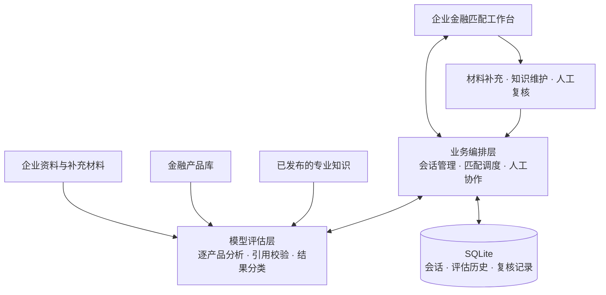

# 桂科融 · 企业金融产品匹配与人工协作

桂科融面向企业金融服务场景，通过分析企业资料与金融产品申请条件，提供有原文依据的匹配结果，并结合材料补充、专业知识和人工复核完善判断。

## 核心能力

- **企业资料管理**：按企业建立会话，支持导入 Markdown 资料文件夹、补充事实和修订材料。
- **金融产品匹配**：逐产品分析申请条件，展示“完全满足”“待核验”“不符合条件”三类结果及条款依据。
- **人机协作**：区分材料待确认与专业要求待解释，支持专业知识维护和人工复核。
- **历史追溯**：保存各轮评估、输入资料和复核记录；资料或知识变化后，提示相关结果需要更新。

## 整体架构

采用前端工作台、业务编排、模型评估和本地持久化的分层结构。企业资料与专业知识共同参与评估，模型结果经过引用校验后展示，并通过人工协作形成后续评估的反馈。



**技术栈**：Python 3.12、FastAPI、Pydantic、HTTPX、SQLite、原生 HTML/CSS/JavaScript，使用 uv 管理依赖；支持 DeepSeek 与火山引擎方舟模型服务。

### 代码职责与扩展位置

参考 [DeepSeek Harness 官方架构](https://github.com/deepseek-ai/deepseek-harness/blob/master/docs/architecture.md) 中的能力分离、持久事件与临时进度分离、上下文投影思路，采用适合本项目规模的 Python 模块组合。由 `main.py` 组装配置、存储、业务编排器和路由，沿用现有依赖即可运行。

| 职责 | 模块 | 修改入口 |
| --- | --- | --- |
| 应用装配与 HTTP 接口 | `main.py`、`harness_api.py` | 路由负责参数与响应，调用业务命令 |
| 会话命令与执行编排 | `harness.py` | 保存资料、冻结匹配输入、知识发布、人工复核及历史继续 |
| 会话与结果的只读投影 | `harness_projection.py` | 回放事件、叠加人工复核、聚合产品历史及计算过期状态 |
| 模型上下文 | `matching_context.py`、`chat_context.py` | 匹配/纠正提示词、统一初筛口径、聊天预算与历史裁剪 |
| 匹配执行与模型适配 | `service.py`、`ark_client.py` | 逐产品并发、一次纠正、错误隔离、模型 HTTP 请求 |
| 判断与证据校验 | `cloud_matching.py`、`supplements.py`、`preliminary_policy.py` | 原文引用、补充范围、反馈及初筛豁免边界 |
| 持久化 | `harness_store.py`、`catalog_store.py` | 事件事务、版本冲突、会话删除、产品目录发布 |
| 临时进度传输 | `streaming.py` | SSE 编码、心跳、断流取消并等待任务退出 |

一次匹配先追加 `match/requested`，保存当轮资料、目录、知识和继续核验上下文，再执行模型请求并保存调用记录，最后追加完成或失败事件。界面通过事件投影读取结果；人工复核只覆盖展示副本，原始模型结果保留。SSE 只转发临时进度，最终结果来自业务层完成持久化后的会话状态。

`FinancialHarness` 支持注入存储和匹配器，测试使用临时 SQLite 与模拟模型响应。投影函数不依赖数据库或模型，可直接重放事件。`cloud_matching.py` 保留原提示词函数和版本常量的导入兼容入口，新代码直接使用 `matching_context.py`。

## 快速开始

准备 Python 3.12 和 uv，在项目目录安装依赖：

```powershell
uv sync --locked
Copy-Item .env.example .env
```

在 `.env` 中填写模型服务密钥及相关配置，已有配置可直接使用。配置项说明见 [.env.example](.env.example)。

首次使用先将产品目录导入 SQLite（已有产品数据库无需重复导入）：

```powershell
uv run --env-file .env python -m app.catalog_import
uv run --env-file .env python -m app.catalog_import --apply
```

第一条只预览，第二条校验全部记录并在一个事务中发布。默认源文件为 `科技金融产品.csv`，默认产品数据库为 `data/products.sqlite3`。

启动本地服务：

```powershell
uv run --env-file .env uvicorn app.main:app --host 127.0.0.1 --port 8000 --reload
```

浏览器访问 <http://127.0.0.1:8000/>。Windows 也可运行 `start.cmd`，以局域网可访问的方式启动。

同一端口只保留一个服务实例，避免旧的 `127.0.0.1` 服务与 `0.0.0.0` 服务同时监听导致本机命中旧代码。`/health` 的 `matching_prompt_version` 显示实际运行的匹配规则版本；与新结果的 `versions.prompt` 使用同一版本常量。

## 使用方式

创建企业会话 → 导入资料 → 选择金融产品并匹配 → 查看结果与依据 → 按需补充材料、专业知识或人工复核。

工作台左侧管理企业会话和资料，中间是对话区与固定输入框，右侧优先展示结论和待核验事项。输入框的“提问”用于解释资料和评估，“补充事实”用于保存新信息并继续匹配。点击条款旁的“补充信息”可自动关联产品和条款；Enter 发送、Shift + Enter 换行。开始或重新匹配使用输入框所选的产品范围。

在输入框直接发送“重新匹配”会启动所选范围的匹配，发送“重新匹配全部产品”会匹配全部产品；操作命令不会当作聊天问题或企业补充事实。普通提问使用精简的结果上下文，企业原文和数据库历史仍完整保留；讨论某个产品时选择它，可带入更针对性的资料与知识。

查看历史轮次时，可以直接针对历史结果提问，回答只使用该轮资料；需要补充事实并进一步匹配时，点击“从这轮继续”，随后在中间输入框操作。

原文引用、人工复核和历史版本收在“依据与复核”“产品详情”中；已明确判断的条款和本轮变化默认折叠。专业知识通过左侧入口单独管理。

通过左侧“企业资料”可以修订或删除已有材料，历史轮次仍保留原版本。若匹配失败，补充已保存，可直接重新匹配，无需重复填写。

左侧会话列表分层展示公司名称、创建时间及历史继续标记；选中项浅蓝高亮。点击每条会话右侧“···”→“删除会话”，在确认弹窗中选择“永久删除”。确认后从会话数据库永久删除该会话的消息、企业资料副本、补充事实、全部匹配轮次、人工复核和模型请求记录，不是隐藏或归档。已独立创建的“历史继续”会话、公共知识库、产品库及本地原始文件保留；其他独立备份/导出文件不在会话删除范围内。删除当前会话后清空页面和草稿。删除采用版本校验及事务，晚到的模型回调不能重新写入已删除会话；原会话已删除的分支仍可使用，但禁用返回原会话入口。

查看历史结果时，可点击右侧“从这轮继续”，或点击产品 / 条款旁的“从这里继续补充”。系统基于该轮企业资料与原始模型评估打开独立工作副本，直接展开对应输入区；不会带入后续补充或继承人工覆盖。补充后可进一步匹配，新评估使用当前产品条件和已发布知识。左侧会话列表标记“历史继续”，可随时返回原会话。

金融产品运行时从 `data/products.sqlite3` 读取，可用 `GUIKERONG_CATALOG_DB` 修改位置。CSV 只用于显式导入，启动、聊天、匹配和专业知识导入不再读取 CSV；数据库不可用时明确提示，不静默退回旧文件。企业资料由使用者自行导入；会话与评估记录仍保存在独立的 `data/harness.sqlite3`。

产品库包含三张表：`catalog_revisions` 保存导入批次和来源版本，`products` 保存该版本的产品及完整原始字段，`catalog_active` 指向当前版本。产品 ID、顺序、申请条件原文及目录版本无损保留；版本名中的 `csv-sha256` 仅标识导入来源，不代表运行时仍在读取 CSV。每个请求读取一致的目录快照，导入后下一请求即可使用新版本，无需重启。历史匹配和知识关联保持原 ID。

更新目录时运行 `uv run --env-file .env python -m app.catalog_import "新版产品.csv"` 预览新增、更新、移除项，再加 `--apply` 发布。相同内容重复导入不增加版本；失败不替换当前版本；旧版本保留，重新导入对应备份可切回该版本。缺少外部编号的 `local-row-*` 产品若换行位置导致 ID 变化会拒绝导入，避免破坏历史关联。源文的编号粘连、逻辑关系和截断问题需要单独校订，迁移不会自动改写申请条件。

匹配结果用于辅助判断，最终结论需结合实际材料与专业复核。专业知识用于解释申请条件，人工补充用于完善企业事实。

用户已将工作台设为宽松初筛：所有没有具体核验标准的概括性条款默认直接通过，不逐项审核或补件。范围包括产业政策、一般法规、银行一般信贷政策/准入/其他条件、科技属性、经营或资信良好、组织健全、创新积分较高等；已有明确反例时仍按事实判断。页面标为“初筛通过”，与有材料依据的通过区分，不表示取得银行审批或合规认证。

明确的国家高新等正式资质、名单、数量、比例、期限、登记开户、授信额度和具体审批结果仍按原文判断。混合条款区分概括部分与具体部分；只要具体必要条件待核验，就不能用概括条款通过代替整体通过。历史不回写，重新匹配后采用新口径。

已核实的人工补充可用于初筛，不因缺少附件而一概否定；经营、财务、还款能力等概括要求不额外索要全套审贷材料。历史亏损不能自动当成当前经营不良的反例，冲突须核对主体、事项和适用期间。继续匹配会明确告知模型上轮与本轮规则是否变化，旧轮补件建议不作为新增申请门槛。

模型判定整体通过、全部申请条款也已通过校验时，整体结论可复用逐条的有效依据，无需重复填写相同引用；不会因整体引用遗漏而错误显示待核验。

## 查证后的专业知识包

[2026-10-27 知识包](knowledge/2026-10-27/README.md) 根据此前理解审查报告整理，每产品一份 Markdown，合并该产品需要的专业解释，正文包含官方来源、查证日期和适用边界。只有确有定义依据的产品补充文件；纯材料缺失、未公开银行规则和截断原文另行记录。

导入到当前 `.env` 配置的知识库：

```powershell
# 先预览：校验产品、原文与文件，尚不发布
uv run --env-file .env python -m app.knowledge_import knowledge/2026-10-27/manifest.json
# 发布：下次匹配或提问时使用
uv run --env-file .env python -m app.knowledge_import knowledge/2026-10-27/manifest.json --apply
```

重复导入相同内容不会产生重复条目；同包新版本追加发布并停用旧版本，手工停用的相同版本不会自动恢复。来源以正文链接保留，不增加知识录入表单字段。发布后刷新工作台，在“专业知识”查看；重新匹配后才会产生采用新知识与新解释口径的结果，历史结论仍保留。
