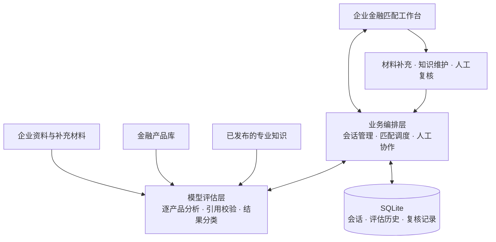

# 桂科融 · 企业金融产品匹配与人工协作

桂科融面向企业金融服务场景，通过分析企业资料与金融产品申请条件，提供有原文依据的匹配结果，并结合材料补充、专业知识和人工复核完善判断。

## 核心能力

- **企业资料管理**：按企业建立会话，支持导入 Markdown 资料文件夹、补充事实和修订材料。
- **金融产品匹配**：逐产品分析申请条件，展示“完全满足”“待核验”“不符合条件”三类结果及条款依据。
- **人机协作**：区分材料待确认与专业要求待解释，支持专业知识维护和人工复核。
- **历史追溯**：保存各轮评估、输入资料和复核记录；资料或知识变化后，提示相关结果需要更新。

## 整体架构

采用前端工作台、业务编排、模型评估和本地持久化的分层结构。企业资料与专业知识共同参与评估，模型结果经过引用校验后展示，并通过人工协作形成后续评估的反馈。



**技术栈**：Python 3.12、FastAPI、Pydantic、HTTPX、SQLite、原生 HTML/CSS/JavaScript，使用 uv 管理依赖；支持 DeepSeek 与火山引擎方舟模型服务。

## 快速开始

准备 Python 3.12 和 uv，在项目目录安装依赖：

```powershell
uv sync --locked
Copy-Item .env.example .env
```

在 `.env` 中填写模型服务密钥及相关配置，已有配置可直接使用。配置项说明见 [.env.example](.env.example)。

启动本地服务：

```powershell
uv run --env-file .env uvicorn app.main:app --host 127.0.0.1 --port 8000 --reload
```

浏览器访问 <http://127.0.0.1:8000/>。Windows 也可运行 `start.cmd`，以局域网可访问的方式启动。

## 使用方式

创建企业会话 → 导入资料 → 选择金融产品并匹配 → 查看结果与依据 → 按需补充材料、专业知识或人工复核。

金融产品默认从根目录的 `科技金融产品.csv` 读取。企业资料由使用者自行导入；会话与评估记录默认保存在本地 SQLite 数据库中。

匹配结果用于辅助判断，最终结论需结合实际材料与专业复核。专业知识用于解释申请条件，人工补充用于完善企业事实。
