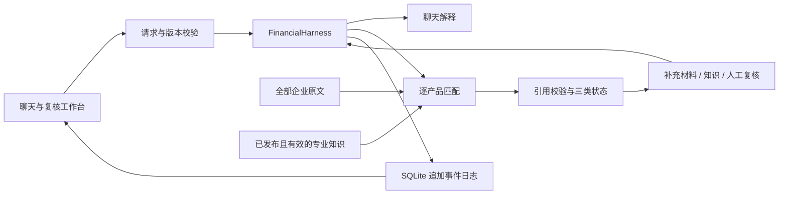

# 桂科融 · 金融匹配与人工协作助手

以企业聊天会话为入口，导入企业资料文件夹，匹配金融产品，再通过补充材料、专业知识及人工复核完善判断。首页 `/` 与 `/chat` 都是聊天工作台。技术栈为 Python 3.12、uv、FastAPI、Pydantic、HTTPX、SQLite 和原生 HTML/CSS/JavaScript。

## 产品状态

| 状态 | 判断依据 | 后续操作 |
|---|---|---|
| 完全满足 `FULLY_SATISFIED` | 校验后的整体资格为 `PASS` | 查看条款与原文依据 |
| 待核验 `PENDING_VERIFICATION` | 整体资格为 `UNKNOWN` | 按原因补充、确认或复核 |
| 不符合条件 `NOT_ELIGIBLE` | 整体资格为 `FAIL` | 查看明确不符合的条件和依据 |

待核验使用 `verification_needs` 数组，允许两种原因同时存在：

- `MATERIAL_CONFIRMATION`：要求已理解，但企业材料、事实、日期或银行确认需要用户补充或进一步明确。
- `PROFESSIONAL_REVIEW`：模型无法可靠理解专业术语、条件逻辑或适用口径，需要专业解释及人工判断。引用失效、核验原因未明确等模型判断问题也交专业人员核对，并明确实际原因，不断言企业缺件。

页面按三种状态分组，可以筛选两类待核验。条款覆盖分为通过条款数 / 总条款数，仅作辅助，不决定产品类别。模型须正确解释“且”“或”和豁免，不能因部分条款满足就整体通过，也不能把已满足的替代路径强制当成所有分支都必须满足。评估失败与产品资料不可用属于处理异常，不算企业不符合条件。

## 启动与配置

1. 运行 `uv sync --locked`。
2. 首次配置时复制 `.env.example` 为 `.env` 并填写模型密钥；已有配置无需覆盖。
3. 运行 `start.cmd`，或在本地运行：

```powershell
uv run --env-file .env uvicorn app.main:app --host 127.0.0.1 --port 8000 --reload
```

打开 `http://127.0.0.1:8000/`。`start.cmd` 监听 `0.0.0.0:8000` 供局域网使用；需要放行时在管理员 PowerShell 执行 `enable-lan.ps1`，仅放行本地子网 TCP 8000。修改配置后重启服务。

示例配置使用 `GUIKERONG_MATCHING_MODE=deepseek` 和独立 `DEEPSEEK_*` 参数；`ark` 模式读取独立的 `ARK_*`。未配置模型仍可打开页面、查看产品，发起匹配或聊天时明确提示配置缺失。`/health` 的 `model_configured` 只表示配置存在，不是连通性测试。

| 配置 | 用途 |
|---|---|
| `GUIKERONG_CSV_PATH` | 产品库，默认根目录 `科技金融产品.csv` |
| `GUIKERONG_HARNESS_DB` | 数据库，默认 `data/harness.sqlite3` |
| `GUIKERONG_ENV` | `development` 或 `production` |
| `GUIKERONG_MATCH_TIMEOUT_SECONDS` | 整轮时限，默认 300 秒 |
| `DEEPSEEK_API_KEY` / `DEEPSEEK_MODEL` | DeepSeek 密钥与模型 |
| `DEEPSEEK_CONCURRENCY` | 并发上限，默认 8 |
| `DEEPSEEK_MAX_PROMPT_CHARACTERS` | 每次完整输入预算，默认 200000 字符 |

完整参数见 `.env.example`。测试不加载真实密钥，不调用付费模型。

## 使用流程

1. 创建企业会话，填写企业法定全称，选择整个资料文件夹。自动包含子目录中的 UTF-8 `.md` 文件，保留相对文件名以区分同名文件，忽略其他类型。也支持多个文件或粘贴资料。默认最多 100 份、单份 1 MiB、正文合计 10 MiB，另受字符预算约束；超限明确提示，不截断原文。
2. 匹配全部或指定产品。按钮下显示真实进度、已处理 / 总产品数及耗时；失败也计入已处理，100% 表示处理结束。结果保存后显示完成，断流显示中断且不会自动重发。
3. 点击匹配消息中的“查看本次结果”查看对应轮次反馈，也可通过右侧轮次选择器回看历史。页面已移除自由聊天输入框，历史消息仍保留。
4. **材料待确认**：填写补充事实，选择适用范围及核实状态，再重新匹配。相关产品旧结果标记需要更新，禁止继续复核。
5. **专业要求待解释**：从条款进入“补充专业知识”，填写解释、来源、作者及范围。草稿经审核发布后用于下一轮匹配；发布本身不触发模型调用。产品专属知识须引用申请条件原文。
6. **人工复核**：选择满足、不符合或待核验，填写审核人、理由与依据。待核验必须选择材料原因、专业原因或两者。修改条款后整体资格需另行综合确认；新一轮不沿用旧条款复核。

专业知识解释条件，不能替代企业证明，也不能新增、删除或放宽产品门槛。企业补充材料是用户提供的事实陈述，引用定位不等于真实性验证。人工复核仅对当前企业、当前轮次有效。知识发布后不可原地修改，修订需新建草稿并停用旧条目；过期、停用或关联产品条件变更后不再注入。

### 人工补充的优先级与采纳反馈

“补充企业事实 / 材料”支持企业通用、指定产品、指定申请条款三种范围。填写事实，并明确“尚未核实”或“我已核实”，系统自动记录保存时间。从条款的“补充 / 确认材料”进入会自动带入产品与可定位的条款原文。

新增事实用于补齐信息；修改资料时选择“修改已有文件”，选中文件后完整原文自动填入编辑框，直接修改并保存即可。保存替换当前会话内该文件的完整内容，保留文件名、文档 ID 及原有适用范围；不要求摘录旧原文，不额外生成更正说明。后续匹配使用新版，历史轮次保留旧版。编辑不会回写上传前的本地文件。普通新增事实不会自动覆盖冲突资料，补充本身不等于通过申请条件，也不改变条款覆盖分的计算公式。

模型输入分为原始 `documents`、适用于本产品的 `human_supplements` 和已发布 `expert_knowledge`。保留完整原文；其他产品的专属补充及绑定条件已变化的补充不发送给本产品模型。模型仍须逐字引用实际使用的文档/补充；尚未核实的补充不能作为明确结论的依据，专业解释仍通过知识库发布。

重跑后产品卡片展示“人工补充处理反馈”：已采用、未采用、冲突待核对、尚需核实，以及原因、影响和关联条款。声明已采用却没有对应条款引用、反馈缺失或引用超出限定条款时，整体结论转交核验，不伪造采纳成功。历史输入、原始判断和采纳反馈按轮次保存，查看旧轮次不会使用新材料。

既有 `documents/added` 事件中的新增文档按事件来源识别为历史人工补充，不凭文件名推断；不重写旧数据，也不把未记录的核实状态自动升级为“已核实”。旧补充也可通过文件编辑器修改。新旧会话均按每个产品实际适用的输入计算是否需要更新。

### 产品总览与历史

右侧默认汇总每个产品最近一次成功评估：先匹配 36 个产品，再单独重跑其中一个，总览仍保留 36 个。可按产品名称、银行和资格状态筛选。每张卡片展示评估时间、“查看历史”和“重新匹配此产品”；消息中的“查看本次结果”与总览轮次选择器可回看某次匹配。页面资源 URL 按文件内容生成版本号，刷新页面时自动获取对应版本，避免沿用旧前端缓存。

单产品历史包含成功、失败和中断尝试，可切换版本，查看当时的申请条件、企业资料、专业知识、模型原始判断及人工复核。历史页只读。现有 SQLite 事件直接生成历史，无须迁移、清空数据库或重新调用模型。

- 补充企业通用事实后，已有结果保留并标记需要更新；指定产品补充只影响该产品。重跑一个产品只更新该产品的结果。
- 发布、停用、到期的专业知识按适用产品标记需要更新；通用知识影响全部适用产品。产品申请条件变化或产品移除，也会标记对应旧结果。
- 旧结果不计入当前状态统计，资格状态仍保留供历史参考。最近一次评估失败或中断时保留此前成功结果并明确提示，重新成功匹配后才允许继续复核。
- 人工复核及企业引用严格关联各产品的来源轮次。重跑 A 不清除 B 的复核；A 的旧复核保存在历史中，不自动继承到 A 的新评估。
- 聊天收到累计产品视图和逐产品更新标记，不再只看到最后一轮。历史版本比较暂通过版本切换查看，未做条款自动对齐。

## Harness 架构

借鉴 [DeepSeek Harness 架构](https://github.com/deepseek-ai/deepseek-harness/blob/master/docs/architecture.md) 的能力分离、上下文组装与持久事件思想，在 Python 服务内实现领域编排；未依赖其 SDK 或实现其插件协议。



- `app/harness.py`：会话、知识生命周期、匹配命令及人工结果投影；模型无直接写入人工结论的权限。
- `app/harness_store.py`：追加事件、事务及版本校验，保留原始模型结果与独立人工依据。
- `app/harness_projection.py`：按产品聚合最新成功评估、最近尝试、来源证据和更新标记；生成轮次详情及历史只读视图。
- `app/supplements.py`：人工补充范围、逐产品输入指纹及采纳反馈校验；模型反馈位于 `model_assessment.supplement_feedback`。
- `app/service.py`、`cloud_matching.py`：每产品独立请求，全部企业原文与产品名称、完整申请条件进入模型。已发布知识单独注入，首次及纠正请求使用同一快照。
- `app/product_status.py`：三类结论、核验原因与后续事项；`scoring.py` 仅计算辅助条款覆盖分。
- `app/history.py`：读取历史快照时转换旧字段，不重写审计事件；未记录核验类型的历史结果会显示重新确认提示。
- `app/static/chat.*`：唯一工作台，支持文件夹选择、SSE 进度、筛选、知识录入与复核。

CSV 仅要求产品名称及申请条件，其余字段保留本地展示，不追加为申请要求。引用只容许换行编码差异，不容许改写或拼接。无依据的确定结论转待核验；企业引文校验失败时只纠正本产品一次。可恢复坏引用被清除并交人工核对。单产品响应失败单独列出，其余结果可交付 `PARTIAL`；供应商或全局错误中止并取消其他请求。初始输入先检查完整预算，不静默截断。

当前为受信任团队共享工作区，访问与审核令牌功能已移除，打开页面自动加载，可直接使用会话、匹配、人工复核和知识维护；能访问服务的用户共享这些功能，尚无租户隔离或实名账号。旧 `GUIKERONG_API_KEY` / `GUIKERONG_REVIEWER_API_KEY` 配置不再读取，模型服务密钥仍由服务端配置。数据库与导出包含企业原文及模型消息，不开放静态访问；备份用 SQLite backup API，或停机后同时处理数据库及未合并的 WAL 文件。

关闭页面会取消匹配，没有后台任务续跑。调用期间发生资料或复核变更时，版本冲突阻止旧请求覆盖新状态。聊天引用是模型生成的解释，仍需结合结构化条款核对。

## API

业务接口前缀为 `/api/v1`，完整结构见 `/docs`。

| 方法 | 路径 | 用途 |
|---|---|---|
| GET | `/financial-products` | 产品库 |
| GET / POST | `/sessions` | 最近会话 / 创建会话 |
| GET | `/sessions/{id}` | 恢复资料、消息、全部产品最新成功结果及轮次索引 |
| GET | `/sessions/{id}/runs/{run_id}` | 本轮输入、结果及人工复核，只读 |
| GET | `/sessions/{id}/products/{product_id}/history` | 单产品全部尝试索引，时间倒序 |
| POST | `/sessions/{id}/messages` | 聊天 |
| POST | `/sessions/{id}/documents` | 追加企业资料 |
| POST | `/sessions/{id}/documents/edit` | 保存已有文件的完整新版内容 |
| POST | `/sessions/{id}/match` | 匹配并返回会话 |
| POST | `/sessions/{id}/match/stream` | 实时进度，保存后返回会话 |
| POST | `/sessions/{id}/reviews` | 人工复核，待核验必须附 `verification_needs` |
| GET | `/sessions/{id}/events` | 导出事件与模型请求 |
| GET / POST | `/knowledge` | 查看知识 / 保存草稿 |
| POST | `/knowledge/{id}/decision` | 发布或停用 |

会话写命令携带最新 `expected_version`，整体复核用 `condition_id="__eligibility__"`，知识审核用条目自身版本。`run.result` 保留最后完成轮次的原始模型快照，`effective_matches` 是所有产品各自最新成功评估叠加对应人工复核的视图。每项包含 `run_id`、`evidence`、`evaluated_at`、`input_revision`、`knowledge_fingerprint`、`history_count`、`stale_reasons`、`latest_attempt` 与 `can_review`。复核必须提交产品自身的 `run_id`，不得统一用 `session.run.id`；证据从产品自身的 `evidence` 读取。`result_counts` 区分总数、输入仍适用数及待更新数；`runs` 和 `product_attempts` 包含失败及中断尝试。

补充命令除 `documents` 外可携带 `supplement`：`verification`（`CONFIRMED` / `UNVERIFIED`）及可选 `product_id` / `condition_quote`。服务端验证范围，自动记录保存时间及产品条件快照，存入新增文档的 `human_supplement`。省略核实状态时按未核实处理；“已核实”是用户声明，不是系统自动外部核验。文件编辑命令包含 `expected_version`、`document_id`、完整 `content`，通过追加 `documents/updated` 事件保存新版，沿用容量校验和版本冲突保护。

模型结果统计满足 `evaluated_count = fully_satisfied_count + pending_count + not_matched_count`，且 `catalog_total = evaluated_count + failed_count + unavailable_count`。排序为完全满足、待核验、不符合条件，同类按覆盖分降序，同分保留目录顺序。

## 迁移与开发

旧单次页面、独立 `/financial-products/match` 及流式接口、CLI、诊断导出、规则树加载器及相关配置已删除。产品库、企业资料、历史导出和会话数据库保留，历史规则文件不再加载。旧 PRD 与流程图只作历史设计资料，当前实现以本文为准。

```powershell
uv run pytest
uv run ruff check app tests
node --check app/static/chat.js
```

测试覆盖离线模型传输、引用纠正、三类结论及两类待核验、人工复核、历史兼容、知识发布、并发冲突、SSE 取消及输入校验。聊天仍依赖的模型适配、原文校验、预算及并发控制继续作为内部模块使用。
